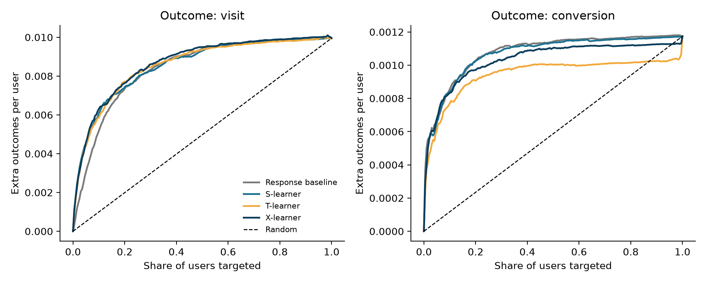
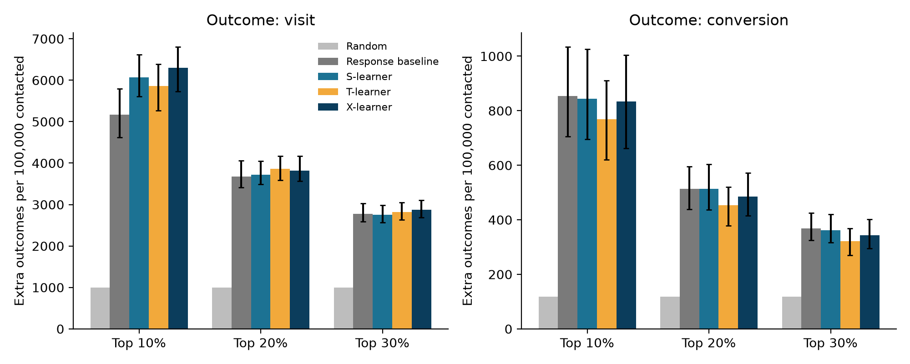
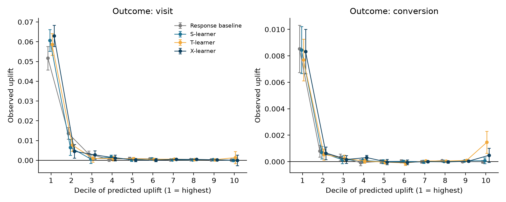
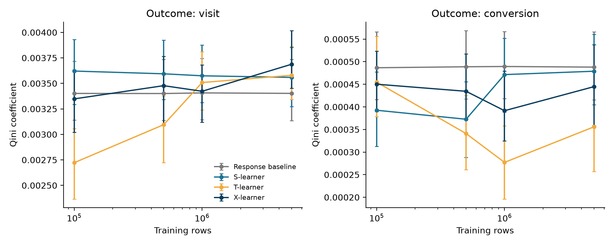

# Who Actually Benefits?

Causal machine learning for targeted intervention, on the Criteo Uplift dataset. CSC1181, Group 12.

A normal prediction model finds who is likely to respond. It cannot tell us whose decision an offer actually changed, because some of those people would have responded anyway. This project estimates the effect of the offer for each person (uplift), so a limited budget goes to the people it persuades.

**Hypothesis H1.** At the same budget, uplift targeting delivers more incremental outcomes than response targeting.

**Our own question.** How much data does uplift targeting need before it beats response targeting? We rerun every model on 100k, 500k, 1M and 5M training rows.

## The answer in short

H1 is partly supported. Uplift models help on visits when the budget is small, and not when the budget is large or the outcome is conversion.

- **Visits, top 10 percent of users.** Targeting with the X-learner gives about 6,300 extra visits per 100,000 users contacted. The response baseline gives about 5,170, and random targeting about 1,000. The X-learner gain over the baseline is about 1,130 extra visits per 100,000 (95 percent interval 728 to 1,442).
- **Visits, 20 and 30 percent budgets.** The gains shrink and their intervals include zero. At these budgets we cannot tell the models apart.
- **Conversion.** No uplift model beats the baseline. The T-learner is clearly worse. Conversion is rare, so these estimates are noisy.
- **Statistical test.** After correcting for three comparisons, the S-learner is significantly better than the baseline on visits, and this holds under every bootstrap seed we tried. The X-learner is borderline: its corrected p value is 0.075 with the seed used for the tables and 0.045 with another, and it is below 0.05 in 10 of 12 further seeds. The T-learner is never significant.
- **Why the gains are modest.** The users most likely to visit are also the users the offer moves most, so response targeting is already a strong baseline. The X-learner finds a top tenth where the offer adds 6.3 percentage points, about 63 percent of the average effect on the Qini curve. The next tenth adds 0.5 points, and from the fourth tenth down the effect is 0.12 points or less.
- **One caution on randomization.** The data description says assignment was random, but a model can predict who was treated slightly better than chance (AUC 0.51). If that reflects real dependence on the features, absolute numbers such as the extra visits above may be overstated by roughly a quarter to a third. The comparisons between models mostly hold. See the last point under "What these results do not show" and notebook 11.

## Results

Everything below is on a fixed holdout of 2,000,000 users that no model was fitted, tuned or selected on, with models trained on 5,000,000 other rows. Visits are the main outcome, because conversion is too rare to develop on.

### Do the uplift models rank users better?

The Qini coefficient is the area between a model's Qini curve and the random line. Larger means better targeting. Intervals are 95 percent bootstrap intervals from 200 resamples, and the same resamples score every model.

| Model | Qini coefficient | Gap to response baseline | One sided p, corrected for 3 tests |
|---|---|---|---|
| Response baseline | 0.00340 (0.00316 to 0.00373) | | |
| S-learner | 0.00356 (0.00331 to 0.00384) | +0.00016 (0.00009 to 0.00023) | 0.015 |
| T-learner | 0.00358 (0.00333 to 0.00389) | +0.00018 (-0.00009 to 0.00046) | 0.33 |
| X-learner | 0.00369 (0.00343 to 0.00402) | +0.00029 (0.00002 to 0.00053) | 0.075 |



### What does that mean for a campaign?

Extra visits per 100,000 users contacted, when only the top share by score is contacted. The last column is the gain over the response baseline.

| Budget | Response | S-learner | T-learner | X-learner | Random | X-learner gain (95% interval) |
|---|---|---|---|---|---|---|
| Top 10% | 5,167 | 6,070 | 5,862 | 6,300 | 995 | +1,133 (728 to 1,442) |
| Top 20% | 3,678 | 3,724 | 3,860 | 3,816 | 995 | +138 (-70 to 318) |
| Top 30% | 2,778 | 2,754 | 2,824 | 2,869 | 995 | +91 (-23 to 192) |



The effect is concentrated. In the top tenth of users by X-learner score, treated users visit 27.8 percent of the time and control users 21.5 percent. The next tenth adds 0.5 percentage points, and from the fourth tenth down the difference is 0.12 points or less in every tenth.



### How much data is needed?



On visits the S-learner is a little ahead of the baseline at every size, with intervals that overlap. Each size was run once, so we do not claim the S-learner's lead is stable. The T-learner is below the baseline until 1M rows. The X-learner is close to the baseline up to 1M rows and ahead at 5M. The baseline stays flat from 100k rows to 5M. Most intervals overlap, so these are tendencies, not firm differences. The exception is 100k rows, where the T-learner interval lies entirely below the baseline and the S-learner.

### Checks that the pipeline is sound

- **Planted effect.** On synthetic data with a known effect, the T-learner scores 0.0060 against 0.0063 for the oracle that knows the truth. A random score gives about 0, and a reversed oracle gives -0.0060.
- **Randomization.** Treated and control users are balanced on all 10 features by the usual rule, with a largest standardized mean difference of 0.054, below 0.1. The balance is not perfect, though. A model can predict who was treated with an AUC of 0.51, and the treated share is 86.0 percent in the top tenth by response score against 84.9 percent in the rest (notebook 11).
- **Seeds.** The response baseline is stable across three seeds (0.00340 to 0.00341). The T-learner is not (0.0032 to 0.0036), so its edge over the baseline is within seed noise. The seed runs use 1M training rows and cover only the baseline and the T-learner.
- **Audit.** Nine checks on the results (no leakage, treated share, curve ends, intervals, oracle bound, bootstrap stability, seed spread, reproducible scores, holdout ids). Seven pass. Two fail and are explained: the X-learner verdict depends on the bootstrap seed, and the T-learner gain is smaller than its seed spread. `results/audit.md` lists the claims we therefore do not make (notebook 12).
- **Repeated rows.** About 11.8 percent of rows are exact copies of an earlier row, and 12.7 percent of holdout rows have an identical twin in the training rows. We kept them. Scoring only the holdout rows with no twin leaves the model ranking unchanged and the gaps at least as large (notebook 10).

## What these results do not show

- Visits are a proxy for interest. They say nothing about revenue, cost per contact or fatigue.
- This is one dataset from one advertiser, and the 12 features are anonymized, so we cannot say which user traits drive the effect.
- Bootstrap intervals resample the holdout rows. They do not capture how much a model changes when it is retrained, which we checked with three seeds for the baseline and the T-learner only.
- Conversion is rare. The holdout has about 590 control conversions, so conversion results are weak evidence either way.
- The file has no user id, so repeated rows cannot be told apart from different users with the same features.
- The Qini and policy numbers describe this holdout. We have no second dataset to confirm them.
- Treatment assignment was not perfectly independent of the features (see the randomization check above). We report the unweighted results, because the data description says assignment was random. With propensity weights the average visit effect falls from 0.0100 to between 0.0067 and 0.0075. All three uplift models still beat the baseline and the X-learner is still best, but the T-learner drops below the S-learner and its gap to the baseline shrinks from 0.00018 to 0.00006. Absolute numbers such as extra visits per 100,000 may therefore be overstated by roughly a quarter to a third. We did not rerun the bootstrap intervals or the policy simulation with weights (notebook 11).

## Method

1. Check that treatment was randomized (standardized mean differences between treated and control).
2. Hold out a fixed 2M row test set once, by seed. Draw nested training samples of 100k, 500k, 1M and 5M rows from the rest.
3. Cut the features by importance on training rows only, from 12 to 10.
4. Tune one LightGBM setting per outcome, shared by the baseline and all three learners, so differences come from the strategy and not from tuning effort.
5. Baseline: a response model that predicts the outcome and ignores treatment.
6. Uplift models behind one interface: S-learner (one model with treatment as a feature), T-learner (one model per group) and X-learner (imputed effects, blended by the treated share).
7. Evaluate with Qini curves, AUUC, uplift by decile, paired bootstrap intervals and a one sided test of each learner against the baseline, corrected for three comparisons.
8. Simulate a targeting policy at 10, 20 and 30 percent budgets.

Every choice and the reason for it is in [docs/decision_log.md](docs/decision_log.md).

## Reproduce

Python 3.12.

```
python3.12 -m venv .venv
source .venv/bin/activate
pip install -r requirements.txt
pip install -e .
python -m uplift.data
pytest
jupyter lab
```

On Windows (PowerShell):

```powershell
py -3.12 -m venv .venv
Set-ExecutionPolicy -Scope Process -ExecutionPolicy Bypass
.venv\Scripts\Activate.ps1
pip install -r requirements.txt
pip install -e .
python -m uplift.data
pytest
jupyter lab
```

`python -m uplift.data` downloads the data (311 MB), checks its SHA256 checksum and converts it to `data/criteo.parquet`. Finished steps are skipped, so it is safe to run again.

Run the notebooks in order, from 01 to 06 and then 08 to 12. Start Jupyter from the activated environment. Otherwise Jupyter can pick another Python on your machine and fail with `No module named 'uplift'`. Conda also works: `conda env create -f environment.yml`, then `pip install -e .`. On a Mac, LightGBM needs libomp: `brew install libomp`.

The reported numbers come from Python 3.12 with the pinned versions. Other Python versions can change the fourth decimal of some metrics. One teammate saw 0.9504 instead of 0.9508 for a baseline AUC on Python 3.14.

Notebook 03 writes the scores files `results/scores_<size>.parquet`. Evaluation only reads them. They are large, so they are not committed. Rerun notebook 03 to rebuild them.

## Where each result comes from

| Result | Notebook | Files in `results/` and `report/` |
|---|---|---|
| Balance and average effect | 01 | `balance_table_1m.csv`, `balance_smd_1m.png`, `ate_visit_conversion.csv` |
| Features, tuning, baseline | 02 | `feature_selection.csv`, `kept_features.json`, `best_params.json`, `tuning_visit.csv`, `tuning_conversion.csv`, `baseline_metrics.csv` |
| Scores for all models | 03 | `scores_100k.parquet` to `scores_5m.parquet` (not committed) |
| Qini, tests, size curve, seeds, sanity check, relative uplift | 04 | `qini_results_visit_5m.csv`, `qini_results_conversion_5m.csv`, `h1_tests_5m.csv`, `size_curve.csv`, `seed_stability_visit.csv`, `sanity_planted_effect.csv`, `uplift_by_decile_5m.csv`, `relative_uplift_bootstrap.csv`, `relative_uplift_rank_correlation.csv`, `relative_uplift_response_deciles.csv`, and the figures `qini_curves.png`, `size_curve.png`, `uplift_by_decile.png`, `relative_uplift.png` |
| Policy simulation, sleeping dogs check | 05 | `policy_simulation_5m.csv`, `policy_simulation.png`, `sleeping_dogs_5m.csv` |
| Tuning sensitivity | 06 | `sensitivity_tuning_visit.csv` |
| Segments | 08 | `segment_uplift_visit.csv`, `segment_uplift_visit.png` |
| Calibration | 09 | `calibration_5m.csv`, `calibration_slopes_5m.csv`, `calibration_5m.png` |
| Repeated rows check | 10 | `duplicate_rows_summary.csv`, `duplicate_rows_check.csv` |
| Treatment assignment check | 11 | `propensity_summary.csv`, `propensity_weighted_qini.csv`, `treated_share_by_score_decile.csv` |
| Audit of the results | 12 | `audit.md` |

## Repo layout

```
causal-uplift/
  README.md
  requirements.txt     pinned versions
  environment.yml      conda wrapper around requirements.txt
  data/                README only, data files are ignored by git
  notebooks/           01 to 06 and 08 to 12, each runs top to bottom
  src/uplift/
    data.py            download, verify, convert, fixed holdout split
    learners.py        S, T and X learners with one interface
    pipeline.py        feature cut, tuning, scores file
    metrics.py         Qini, AUUC, bootstrap, uplift by decile
  tests/               unit tests with a planted effect, run with pytest
  results/             tables, figures and scores files
  report/              figures, report sections, references and the word count script
  docs/decision_log.md one line per decision, and why
```

## How we worked

- One branch per task, merged by pull request, with a review from a teammate.
- Fixed seeds and one frozen holdout. Nobody splits again.
- Test rows are never used to fit, tune or select anything.
- Every figure and number has code that regenerates it.
- The raw data is never committed.

## Data and licence

See [data/README.md](data/README.md) for the links, the checksum and two warnings: the file is ordered, so never take the first rows, and conversion is rare.

The dataset is CC BY-NC-SA 4.0, so we use it for coursework only, with attribution to Criteo. It is anonymized and contains no personally identifying information. Official page: https://ailab.criteo.com/criteo-uplift-prediction-dataset/
